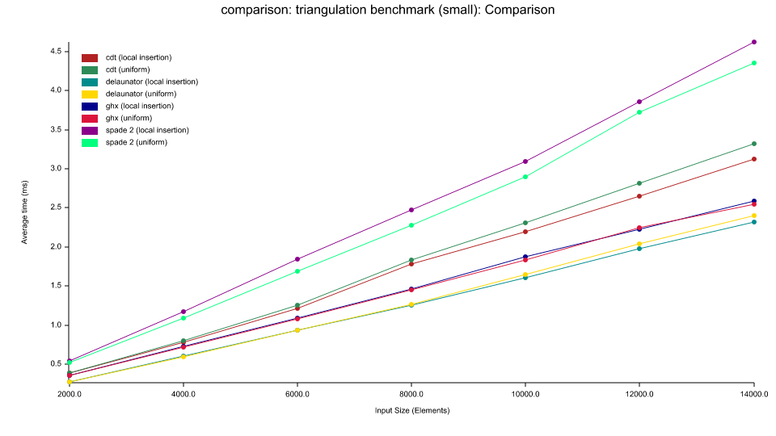
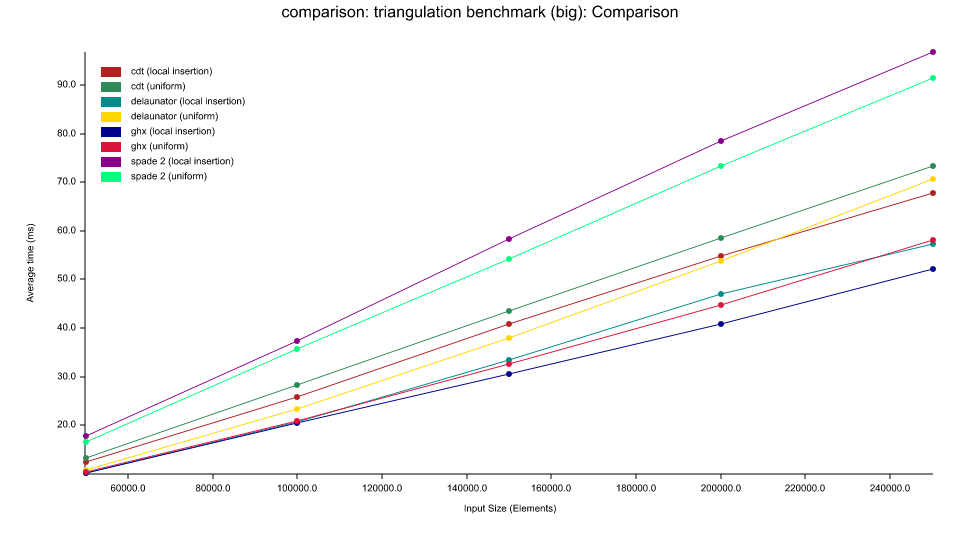

# Benchmarks

Small benchmark suite for comparing different (constrained) Delaunay triangulation implementations in rust, modified from the [spade](https://github.com/Stoeoef/spade/tree/master/delaunay_compare) crate comparison benchmark.

#### Crates tested

| Crate                                                                                   | DT   | CDT  |
| :-------------------------------------------------------------------------------------- | :--- | :--- |
| [delaunator 1.1.0](https://crates.io/crates/delaunator)                                 | Yes  | No   |
| [cdt 0.1.0](https://crates.io/crates/cdt)                                               | Yes  | Yes  |
| [spade 2.15.1](https://crates.io/crates/spade)                                          | Yes  | Yes  |
| [ghx_constrained_delaunay](https://github.com/Henauxg/ghx_constrained_delaunay) (this repository) | Yes  | Yes  |

## Constrained Delaunay triangulation (CDT) measures

This benchmark bulk loads mutliple real data set (shapefiles):
- **ne_50m_coastline**: 60416 vertices, 58987 constraint edges
- **ne_10m_coastline**: 410957 vertices, 406581 constraint edges
- **Europe_coastline**: 2912812 vertices, 2837094 constraint edges

The shapefiles contain consecutive duplicate points. The zero-length constraint edges between them are removed before loading, since spade and the `cdt` crate reject them.

Run it with `cargo run --release --example cdt_benchmark` in the `benchmarks` directory.

### Results

The dataset is both loaded with constraint edges and without (as if it was a regular Delaunay triangulation).


| ne_50m_coastline.shp     | ghx_constrained_delaunay | Spade | cdt crate |
| ------------------------ | ------------------------ | ----- | --------- |
| Without constraint edges | **16ms**                 | 23ms  | 16ms      |
| With constraint edges    | **18ms**                 | 37ms  | 29ms      |
| With stable vertex order | -                        | 37ms  | -         |

| ne_10m_coastline.shp     | ghx_constrained_delaunay | Spade | cdt crate |
| ------------------------ | ------------------------ | ----- | --------- |
| Without constraint edges | **114ms**                | 180ms | 148ms     |
| With constraint edges    | **133ms**                | 284ms | 245ms     |
| With stable vertex order | -                        | 286ms | -         |

| Europe_coastline.shp     | ghx_constrained_delaunay | Spade  | cdt crate |
| ------------------------ | ------------------------ | ------ | --------- |
| Without constraint edges | **887ms**                | 1588ms | 2550ms(*) |
| With constraint edges    | **1028ms**               | 2329ms | 2064ms    |
| With stable vertex order | -                        | 2328ms | -         |

_Median of 5 runs, obtained on an i7-14700KF CPU @ 3.40GHz, date: 15/11/2026_

*The benchmark also includes a stable bulk load variant for spade that keeps the relative vertex order consistent*

(*) It seems weird that the `cdt` crate takes **less** time with constraints than without on this specific dataset. I need to look at the implementation.


## Delaunay triangulation (DT) measures

Two point distributions are tested:
 - **uniform**: `f64` coordinates are uniformly distributed in a given interval
 - **local insertion**: consecutive input points are located close to each other. A point is generated by adding a random step (with a fixed maximum length) to the last inserted point (random walk). This creates a more skewed input set.

Run it with ```cargo bench``` in the `benchmarks` directory.

Results are stored in `<repository_root>/target/criterion`.

### Results

For better comparability, measurements are grouped in point sets with less than 14000 vertices ("small") and more than 50000 vertices ("big").

<p align="center"></p>
<p align="center"></p>

_Results obtained on an i7-14700KF CPU @ 3.40GHz, date: 15/11/2026_

## Credits

See the [spade](https://github.com/Stoeoef/spade) crate for the original benchmark.

## Differences with the original benchmark

- Added the [ghx_constrained_delaunay]("https://github.com/Henauxg/ghx_constrained_delaunay") crate.
